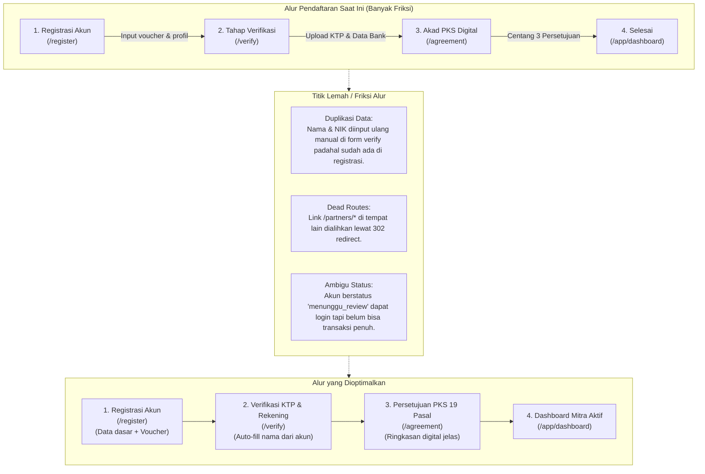
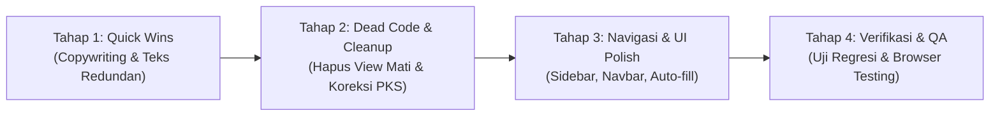

# AUDIT KONTEN, UI/UX, DAN FITUR WEB APP AMANAH SAFAR
**Dokumen Analisis Produk, UI/UX, dan Arsitektur Perangkat Lunak**  
*Tanggal Audit: 17 Oktober 2026 | Auditor: Senior Product Analyst, UI/UX Auditor, & Software Architect*  
*Status Kode: Read-Only (Tidak Ada Perubahan Kode atau Basis Data Selama Audit)*

---

## DAFTAR ISI
1. [Bagian 1 — Ringkasan Eksekutif](#bagian-1--ringkasan-eksekutif)
2. [Bagian 2 — Inventaris Audit](#bagian-2--inventaris-audit)
3. [Bagian 3 — Temuan Teks dan Konten yang Terlalu Panjang, Berulang, atau Tidak Perlu](#bagian-3--temuan-teks-dan-konten-yang-terlalu-panjang-berulang-atau-tidak-perlu)
4. [Bagian 4 — Temuan Fitur, Komponen UI, atau Informasi yang Berpotensi Berlebihan](#bagian-4--temuan-fitur-komponen-ui-atau-informasi-yang-berpotensi-berlebihan)
5. [Bagian 5 — Temuan Alur Pengguna yang Terlalu Panjang atau Berbelit](#bagian-5--temuan-alur-pengguna-yang-terlalu-panjang-atau-berbelit)
6. [Bagian 6 — Hal yang Harus Dipertahankan (Critical Features)](#bagian-6--hal-yang-harus-dipertahankan-critical-features)
7. [Bagian 7 — Rekomendasi Berdasarkan Prioritas](#bagian-7--rekomendasi-berdasarkan-prioritas)
8. [Bagian 8 — Rencana Implementasi Tahap Berikutnya](#bagian-8--rencana-implementasi-tahap-berikutnya)
9. [Bagian 9 — Metode dan Batasan Audit](#bagian-9--metode-dan-batasan-audit)

---

## BAGIAN 1 — RINGKASAN EKSEKUTIF

### 1.1 Latar Belakang & Tujuan Audit
Audit ini dilakukan secara menyeluruh terhadap aplikasi web **Amanah Safar** (`amanahsafar`) dengan perspektif gabungan *Product Management*, *UI/UX Engineering*, dan *Software Architecture*. Tujuan utamanya adalah mengidentifikasi:
1. Redundansi konten, instruksi yang bertele-tele, placeholder yang mengulang label, serta inkonsistensi bahasa.
2. Komponen UI mati (*dead UI*), elemen dekoratif tanpa interaktivitas, duplikasi tombol aksi, dan kontrol visual yang membingungkan.
3. Gesekan alur pengguna (*user flow friction*), khususnya pada proses onboarding pendaftaran mitra (registrasi $\rightarrow$ verifikasi identitas & rekening $\rightarrow$ akad PKS) serta alur pemesanan.
4. Kode tidak terpakai (*dead code / orphaned views & routes*) yang membebani pemeliharaan jangka panjang.

### 1.2 Ringkasan Metrik Temuan
Dari pemeriksaan terhadap **27 file Controller**, **55 file View**, konfigurasi routing (`app/Config/Routes.php`), dan seluruh komponen antarmuka, ditemukan total **34 temuan utama**:

| Klasifikasi Prioritas | Jumlah Temuan | Persentase | Karakteristik Utama |
| :--- | :---: | :---: | :--- |
| **P1 — Kritis / Tinggi** | 7 temuan | 20.6% | Elemen interaktif mati (lonceng notifikasi palsu), inkonsistensi dokumen hukum (PKS 14 pasal usang vs 19 pasal resmi), link navigasi profil hilang di sidebar bawah, dan validasi form ganda. |
| **P2 — Sedang** | 16 temuan | 47.1% | *Dead code* & *orphaned routes* (`Partners.php` dan `landing_payungmadinah.php`), inkonsistensi terminologi bilingual pada sidebar/kartu statistik, redundansi kontrol visual, serta duplikasi kartu ringkasan. |
| **P3 — Rendah / Polish** | 11 temuan | 32.3% | Placeholder form yang mengulang teks label secara harfiah, microcopy/instruksi bertele-tele, kalimat pasif yang tidak perlu, dan padding/spasi vertikal berlebih. |

### 1.3 Kondisi Kesehatan Aplikasi Saat Ini
Secara umum, arsitektur dasar Amanah Safar dibangun dengan pondasi yang solid: pemisahan hak akses berbasis peran (*Role-Based Access Control*), integritas pencatatan keuangan mutasi komisi (*double-entry like ledger*), perlindungan CSRF, dan validasi berkas upload. Namun, aplikasi mengalami pembengkakan mikro (*micro-bloat*) akibat pertumbuhan fitur secara bertahap tanpa pembersihan rutin. Penerapan prinsip *"Less is More"* dan konsistensi panduan antarmuka (`rules_ui.md`) akan secara drastis meningkatkan kepuasan pengguna, mempercepat pemahaman antarmuka, dan meringankan beban kognitif mitra maupun administrator.

---

## BAGIAN 2 — INVENTARIS AUDIT

Audit memeriksa seluruh artefak yang dapat diidentifikasi dari konfigurasi routing dan pohon berkas direktori `app/`:

### 2.1 Modul Publik & Katalog
| Halaman / Fitur | Rute URL | Berkas View Utama | Pengontrol Terkait |
| :--- | :--- | :--- | :--- |
| **Landing Page Publik** | `GET /` | `app/Views/landing.php` | `app/Controllers/Home::index` |
| **Landing Alternatif (Orphaned)** | *Tidak ada rute* | `app/Views/landing_payungmadinah.php` | *Tidak ada (Orphaned View)* |
| **Katalog Paket Terbuka** | `GET /catalog` | `app/Views/catalog/index.php` | `app/Controllers/Catalog::index` |
| **Detail Paket Terbuka** | `GET /catalog/(:num)` | `app/Views/catalog/detail.php` | `app/Controllers/Catalog::detail` |
| **Mode Pemeliharaan** | `GET /maintenance` | `app/Views/maintenance.php` | `app/Controllers/Maintenance::index` |

### 2.2 Modul Autentikasi & Onboarding Kemitraan
| Halaman / Fitur | Rute URL | Berkas View Utama | Pengontrol Terkait |
| :--- | :--- | :--- | :--- |
| **Login Pengguna & Admin** | `GET|POST /login` | `app/Views/auth/login.php` | `app/Controllers/Auth::login` |
| **Registrasi Mitra Ber-Voucher** | `GET|POST /register` | `app/Views/auth/register.php` | `app/Controllers/Auth::register` |
| **Tahap 1: Verifikasi KYC & Bank** | `GET|POST /verify` | `app/Views/auth/verify.php` | `app/Controllers/Auth::verify` |
| **Tahap 2: Persetujuan PKS Digital** | `GET|POST /agreement` | `app/Views/auth/agreement.php` | `app/Controllers/Auth::agreement` |
| **Rute Mitra Duplikat (Redirects)** | `GET /partners/*` | `app/Views/partners/*` (4 views) | `app/Controllers/Partners.php` |

### 2.3 Modul Akun & Shared Components
| Halaman / Fitur | Rute URL | Berkas View Utama | Pengontrol Terkait |
| :--- | :--- | :--- | :--- |
| **Pengaturan Profil & Crop Foto** | `GET /profile`, `POST /profile/update` | `app/Views/profile.php` | `app/Controllers/Profile.php` |
| **Komponen Kartu PKS Profil** | *Included Component* | `app/Views/shared/profile_pks_card.php` | *Rendered in Profile* |
| **Simulasi Komisi Modal** | *Included Component* | `app/Views/shared/commission_simulation.php` | `public/assets/js/commission-simulation.js` |
| **Alokasi Komisi Katalog** | *Included Component* | `app/Views/shared/catalog_commission.php` | `app/Libraries/CatalogCommission.php` |
| **Template Cetak PKS PDF** | `GET /superadmin/verifications/(:num)/pks` | `app/Views/superadmin/verification_pks_print.php` | `app/Controllers/SuperAdmin/Verification::pks` |

### 2.4 Modul Portal Member / Kemitraan (`/app`)
| Halaman / Fitur | Rute URL | Berkas View Utama | Pengontrol Terkait |
| :--- | :--- | :--- | :--- |
| **Dashboard Mitra** | `GET /app/dashboard` | `app/Views/member/dashboard.php` | `app/Controllers/Member/Dashboard.php` |
| **Katalog Paket Member** | `GET /app/packages` | `app/Views/member/packages.php` | `app/Controllers/Member/Package.php` |
| **Pohon Jaringan Binaan** | `GET /app/binaan` | `app/Views/member/binaan.php` | `app/Controllers/Member/Binaan.php` |
| **Kelola Pesanan Member** | `GET /app/orders` | `app/Views/member/orders.php` | `app/Controllers/Member/Order.php` |
| **Detail Pesanan & Bukti Bayar** | `GET /app/orders/(:num)` | `app/Views/member/order_detail.php` | `app/Controllers/Member/Order.php` |
| **Buku Mutasi Komisi & Penarikan** | `GET /app/commissions` | `app/Views/member/commissions.php` | `app/Controllers/Member/Commission.php` |
| **Tugas Promosi & Broadcast** | `GET /app/tasks` | `app/Views/member/tasks.php` | `app/Controllers/Member/Task.php` |

### 2.5 Modul Manajemen Super Admin (`/superadmin`)
| Halaman / Fitur | Rute URL | Berkas View Utama | Pengontrol Terkait |
| :--- | :--- | :--- | :--- |
| **Dashboard Metrik Super Admin** | `GET /superadmin/` | `app/Views/superadmin/dashboard.php` | `app/Controllers/SuperAdmin/Dashboard.php` |
| **Kelola Landing Page & Slides** | `GET /superadmin/landing` | `app/Views/superadmin/landing/index.php` | `app/Controllers/SuperAdmin/LandingContent.php` |
| **Kelola Voucher Kemitraan** | `GET /superadmin/vouchers` | `app/Views/superadmin/vouchers.php` | `app/Controllers/SuperAdmin/Voucher.php` |
| **Katalog Paket (List/Grid/Bulk)** | `GET /superadmin/packages` | `app/Views/superadmin/packages.php` | `app/Controllers/SuperAdmin/Package.php` |
| **Form Tambah/Edit Paket** | `GET /superadmin/packages/create` | `app/Views/superadmin/package_form.php` | `app/Controllers/SuperAdmin/Package.php` |
| **Kelola Pesanan Umrah** | `GET /superadmin/orders` | `app/Views/superadmin/orders.php` | `app/Controllers/SuperAdmin/Order.php` |
| **Detail & Verifikasi Pesanan** | `GET /superadmin/orders/(:num)` | `app/Views/superadmin/order_detail.php` | `app/Controllers/SuperAdmin/Order.php` |
| **Kelola Pengguna (Aktif & Trash)** | `GET /superadmin/users` | `app/Views/superadmin/users.php` | `app/Controllers/SuperAdmin/User.php` |
| **Kelola Penarikan Komisi** | `GET /superadmin/withdrawals` | `app/Views/superadmin/withdrawals.php` | `app/Controllers/SuperAdmin/Commission.php` |
| **Kelola Tugas Promosi** | `GET /superadmin/tasks` | `app/Views/superadmin/tasks.php` | `app/Controllers/SuperAdmin/Task.php` |
| **Verifikasi KYC & Rekening** | `GET /superadmin/verifications` | `app/Views/superadmin/verifications.php` | `app/Controllers/SuperAdmin/Verification.php` |
| **Detail Verifikasi & Validasi** | `GET /superadmin/verifications/(:num)` | `app/Views/superadmin/verification_detail.php` | `app/Controllers/SuperAdmin/Verification.php` |

### 2.6 Modul Admin Operasional (`/admin`)
| Halaman / Fitur | Rute URL | Berkas View Utama | Pengontrol Terkait |
| :--- | :--- | :--- | :--- |
| **Dashboard Operasional** | `GET /admin/` | `app/Views/admin/dashboard.php` | `app/Controllers/Admin/Dashboard.php` |
| **Katalog Paket Operasional** | `GET /admin/packages` | `app/Views/admin/packages.php` | `app/Controllers/Admin/Package.php` |
| **Kelola Pesanan Operasional** | `GET /admin/orders` | `app/Views/admin/orders.php` | `app/Controllers/Admin/Order.php` |
| **Kelola Komisi Operasional** | `GET /admin/commissions` | `app/Views/admin/commissions.php` | `app/Controllers/Admin/Commission.php` |
| **Kelola Tugas Promosi** | `GET /admin/tasks` | `app/Views/admin/tasks.php` | `app/Controllers/Admin/Task.php` |

---

## BAGIAN 3 — TEMUAN TEKS DAN KONTEN YANG TERLALU PANJANG, BERULANG, ATAU TIDAK PERLU

Pemeriksaan teks mengacu pada kaidah penulisan ringkas, jelas, dan profesional: hilangkan kata pengisi (*filler words*), hindari pengulangan informasi yang sama di label, placeholder, dan helper text, serta gunakan bahasa lugas.

### 3.1 Tabel Temuan Teks dan Konten
| No | Lokasi / File / Baris | Teks Saat Ini | Masalah | Rekomendasi Teks Baru | Tindakan | Prioritas | Keyakinan |
| :---: | :--- | :--- | :--- | :--- | :---: | :---: | :---: |
| **T-01** | `app/Views/auth/login.php#L562-L575` | **Label:** Email Aktif **Placeholder:** `nama@email.com` **Helper:** *Masukkan alamat email aktif yang terdaftar pada akun Anda.* | Tiga elemen menyampaikan hal yang identik secara berulang. Kata "Aktif" pada label dan helper menambah beban baca tanpa informasi baru. | **Label:** Alamat Email **Placeholder:** `nama@email.com` **Helper:** *(Hapus helper text)* | `Ringkas` | P3 | 98% |
| **T-02** | `app/Views/auth/login.php#L580-L594` | **Label:** Kata Sandi **Placeholder:** `Masukkan kata sandi akun Anda` | Placeholder mengulang label dengan kalimat instruksi panjang. | **Label:** Kata Sandi **Placeholder:** `Kata sandi akun` | `Ringkas` | P3 | 95% |
| **T-03** | `app/Views/auth/login.php#L623` | `&copy; 2026 PT Amanah Tangguh Mandiri. All Rights Reserved. \| Amanah Safar Digital Platform.` | Legal disclaimer terlalu panjang dan redundan untuk footer kartu kecil di form autentikasi. | `&copy; 2026 Amanah Safar. Hak cipta dilindungi.` | `Ringkas` | P3 | 90% |
| **T-04** | `app/Views/auth/register.php#L541-L551` | **Callout Box:** *Pastikan Anda memiliki Kode Voucher dari Pembina. Voucher ini otomatis menentukan tingkat akses (Cabang, Manager Mitra, atau Mitra) dan jaringan pembinaan Anda.* | Teks penjelasan mengulang apa yang sudah tertulis di panel kiri (L498) dan badge input voucher (L578). | *(Hapus callout amber ini atau ringkas menjadi 1 baris di bawah input voucher)*: `Voucher menentukan tingkat kemitraan dan pembina langsung Anda.` | `Ringkas` | P2 | 92% |
| **T-05** | `app/Views/auth/register.php#L575-L588` | **Label:** Kode Voucher * **Badge:** Wajib Dimiliki **Placeholder:** `masukan kode voucher` | Huruf kecil tidak rapi (`masukan kode voucher`) dan placeholder hanya mengulang nama label. | **Label:** Kode Voucher * **Placeholder:** `Contoh: VCR-ABC123` | `Perjelas` | P3 | 95% |
| **T-06** | `app/Views/auth/register.php#L595-L605` | **Label:** Nama Lengkap * **Placeholder:** `masukan nama anda` | Penulisan tidak baku dan mengulang label. | **Label:** Nama Lengkap * **Placeholder:** `Nama sesuai KTP` | `Perjelas` | P3 | 95% |
| **T-07** | `app/Views/auth/verify.php#L596-L598` | **Status Box:** *Unggah foto KTP asli Anda pada kotak di atas. Sistem akan memeriksa format citra, memastikan dokumen KTP Indonesia yang sah, serta mencocokkan NIK dan Nama Anda secara otomatis.* | Paragraf terlalu panjang dan bertele-tele pada container status yang seharusnya ringkas dan fokus pada instruksi cepat. | `Unggah foto KTP asli yang jelas dan terbaca. Sistem akan memverifikasi NIK dan nama secara otomatis.` | `Ringkas` | P2 | 93% |
| **T-08** | `app/Views/auth/verify.php#L618-L631` | **Label:** Nama Sesuai KTP * **Placeholder:** `Contoh: AHMAD DAHLAN (Sesuai KTP)` **Helper:** *Pastikan nama lengkap persis seperti yang tertera pada kartu identitas KTP Anda.* | Frasa "Sesuai KTP" diulang 3 kali berturut-turut pada 1 komponen input tunggal. | **Label:** Nama Lengkap (KTP) * **Placeholder:** `Contoh: Ahmad Dahlan` **Helper:** *(Hapus helper text)* | `Ringkas` | P3 | 96% |
| **T-09** | `app/Views/auth/verify.php#L635-L649` | **Label:** Nomor Induk Kependudukan (NIK KTP - 16 Digit) * **Placeholder:** `Contoh: 3201012345670001` **Helper:** *Wajib 16 digit angka sesuai KTP resmi. 1 NIK hanya berlaku untuk 1 akun kemitraan.* | Keterangan "16 Digit" disebutkan dua kali di label dan helper. | **Label:** NIK (Nomor Induk Kependudukan) * **Placeholder:** `16 digit angka KTP` **Helper:** *1 NIK hanya berlaku untuk 1 akun kemitraan.* | `Ringkas` | P2 | 94% |
| **T-10** | `app/Views/auth/verify.php#L726-L747` | **Error & Helper Rekening:** Dua span berdampingan: `Nama pemilik rekening harus sama persis dengan nama pada KTP.` `Nama pemilik rekening bank wajib sama persis dengan nama identitas KTP Anda.` | Kalimat persis diulang 2 baris berurutan dengan sedikit variasi kata sambung. Membingungkan pengguna saat pesan validasi muncul. | Satukan menjadi 1 baris helper dinamis: `Nama pemilik rekening wajib identik dengan identitas KTP.` | `Gabungkan` | P1 | 99% |
| **T-11** | `app/Views/superadmin/verification_detail.php#L236-L300` | **Ringkasan Klausul PKS:** Menampilkan Pasal 1 s.d. Pasal 12 (versi 14 pasal usang, misalnya Pasal 7 BSI No. 7275610601). | **Konflik Konten Hukum Berat:** PKS aplikasi telah disahkan menggunakan naskah resmi 19 pasal (`PKS_Mitra_Amanah_Utuh_v1_0_Rapi.pdf`). Kotak ringkasan usang ini memuat pasal kadaluwarsa dan nomor rekening hardcoded yang sudah tidak sesuai dengan Pasal 6 dan Lampiran 1 PKS resmi. | Hapus seluruh kotak scroll ringkasan 14 pasal ini. Gantikan dengan kartu rujukan resmi yang merujuk ke dokumen PKS 19 pasal utuh dan tombol "Buka & Cetak Dokumen PKS Utuh". | `Hapus` | P1 | 100% |
| **T-12** | `app/Views/superadmin/users.php#L86-L139` | **Label Kartu Statistik:** `Active Users`, `Banned / Nonaktif`, `KYC Verified`, `KYC Review`, `KYC Unverified`, `Total Users`. | Pencampuran Bahasa Inggris dan Bahasa Indonesia secara acak pada satu layar dashboard (*Bilingual Jargon*), melanggar `rules_ui.md` Bagian 5. | Ubah seluruhnya ke Bahasa Indonesia baku: `Pengguna Aktif`, `Pengguna Nonaktif`, `KYC Terverifikasi`, `KYC Menunggu Review`, `KYC Belum Lengkap`, `Total Pengguna`. | `Perjelas` | P2 | 96% |
| **T-13** | `app/Views/layouts/sidebar.php#L36, L47, L56, L64` | **Menu Sidebar:** `Tasks` pada menu SuperAdmin, Admin, Pusat, dan Member. | Kata "Tasks" dalam Bahasa Inggris diasosiasikan dengan internal to-do list / project tracker, padahal isinya adalah tugas syiar, materi promosi, dan broadcast copywriting. | Ubah label menu menjadi: `Tugas & Promosi` atau `Materi Promosi`. | `Perjelas` | P2 | 95% |
| **T-14** | `app/Views/layouts/sidebar.php#L40-L48` | **Menu SuperAdmin:** `Landing Page`, `Vouchers`, `Users`, `Verifications`, `Tasks` bersanding dengan `Katalog Paket`, `Kelola Pesanan`, `Komisi`, `Penarikan Dana`. | Separuh menu berbahasa Inggris, separuh berbahasa Indonesia tanpa pola konsisten. | Standarisasi Bahasa Indonesia: `Halaman Depan`, `Voucher Kemitraan`, `Data Pengguna`, `Verifikasi Pengguna`, `Tugas & Promosi`. | `Perjelas` | P2 | 95% |
| **T-15** | `app/Views/superadmin/package_form.php#L80, L156, L164` | **Placeholder Form Paket:** `placeholder="Contoh: Paket Umroh VIP Plus Thaif 12 Hari"` `placeholder="Contoh: 9D, 12D Free Thaif, 13D"` `placeholder="Contoh: Saudia Airlines, Garuda Indonesia"` | Kata "Contoh:" diulang di setiap kolom input, membuat kolom form terkesan penuh sesak (*cluttered*). | Hilangkan prefiks "Contoh:": `placeholder="Paket Umroh VIP 12 Hari"` `placeholder="12 Hari (Free Thaif)"` `placeholder="Saudia Airlines / Garuda"` | `Ringkas` | P3 | 92% |
| **T-16** | `app/Views/profile.php#L140` | `Biarkan kolom-kolom password ini kosong jika Anda tidak ingin mengubah password akun saat ini.` | Kalimat terlalu panjang dan pasif. | `Kosongkan jika tidak ingin mengubah kata sandi.` | `Ringkas` | P3 | 95% |

---

## BAGIAN 4 — TEMUAN FITUR, KOMPONEN UI, ATAU INFORMASI YANG BERPOTENSI BERLEBIHAN

Pemeriksaan komponen antarmuka mengacu pada prinsip fungsionalitas nyata (*functional honesty*): setiap elemen visual yang ditampilkan harus memiliki kegunaan yang jelas, tidak boleh ada kontrol mati atau tombol palsu, dan informasi harus disajikan secara hierarkis tanpa duplikasi.

### 4.1 Tabel Temuan Fitur dan Komponen UI
| No | Lokasi / Komponen | Fitur / Elemen | Bukti Masalah | Rekomendasi | Dampak / Risiko | Prioritas | Tindakan |
| :---: | :--- | :--- | :--- | :--- | :--- | :---: | :---: |
| **UI-01** | `app/Views/layouts/navbar.php#L29-L32` | **Tombol Lonceng Notifikasi & Dot Merah** | Tombol lonceng `<button>` memiliki indikator dot merah statis `bg-red-500` permanen. Namun, ketika diklik sama sekali tidak ada respon (tidak ada dropdown, tidak ada modal, tidak ada tautan URL). | **Rekomendasi 1 (Paling Aman):** Sembunyikan/hapus tombol lonceng sampai modul notifikasi interaktif diimplementasikan. **Rekomendasi 2:** Jika tetap ditampilkan, hilangkan dot merah palsu dan beri tooltip "Belum ada notifikasi baru". | Menghilangkan frustrasi pengguna yang berkali-kali mengeklik lonceng karena mengira ada notifikasi penting yang belum dibaca. | **P1** | `Hapus` / `Perjelas` |
| **UI-02** | `app/Views/layouts/sidebar.php#L104-L121` | **Profil Akun di Sudut Kiri Bawah Sidebar** | Menampilkan avatar, nama lengkap, dan peran, namun elemen pembungkusnya adalah `
` polos tanpa tautan ke halaman profil (`/profile`). Pengguna yang ingin mengedit profil terpaksa mencari dropdown di pojok kanan atas navbar. | Bungkus baris profil bawah sidebar menjadi tautan `<a href="<?= base_url('/profile') ?>" class="hover:bg-purple-50 ...">` dengan indikator visual hover lembut. | Mempercepat navigasi pengguna ke pengaturan profil secara alami tanpa menambah elemen baru. | **P1** | `Gabungkan` |
| **UI-03** | `app/Views/superadmin/packages.php#L36-L46, L115-L120` | **Duplikasi Tombol Mode View & Seleksi Grid** | Di bagian toolbar atas terdapat toggle `Grid` / `List`. Di bawah toolbar muncul sub-bar khusus `selectAllPackages` hanya saat mode grid aktif. Pada saat beralih ke mode list, tabel memiliki checkbox `selectAll` sendiri. Terjadi fragmentasi interaksi bulk-action. | Satukan kontrol seleksi massal (*Select All*) langsung ke dalam toolbar utama atau tampilkan bar seleksi mengambang (*floating bulk action bar*) secara terpadu tanpa memicu pergeseran layout (*layout shift*). | Menghilangkan lompatan layout vertikal saat berganti antara tampilan kartu dan tabel. | **P2** | `Gabungkan` |
| **UI-04** | `app/Views/landing_payungmadinah.php` | **File View Orphaned (Unreferenced View)** | Berkas `landing_payungmadinah.php` (ukuran 41 KB) ada di dalam direktori `app/Views/`, tetapi sama sekali tidak dipanggil atau dirujuk oleh controller manapun di `app/Config/Routes.php` maupun `app/Controllers/`. | Hapus file `landing_payungmadinah.php` dari repository atau arsipkan ke direktori dokumentasi non-produksi jika merupakan artefak historis. | Membersihkan codebase dari dead code dan mengurangi ukuran repositori. | **P2** | `Hapus` |
| **UI-05** | `app/Controllers/Partners.php` & `app/Views/partners/*` | **Rute & View Orphaned (Dead Code)** | Seluruh method dalam `Partners.php` (`login`, `register`, `verification`, `agreement`, `test`) hanya berisi baris `return redirect()->to(...)` ke rute standar `/login`, `/register`, dll. Akibatnya, 4 file view di `app/Views/partners/` (`login.php`, `register.php`, `verification.php`, `agreement.php`) 100% mati dan tidak pernah dieksekusi. | 1. Hapus direktori `app/Views/partners/`. 2. Evaluasi apakah rute `/partners/*` masih dibutuhkan untuk backwards compatibility link lama. Jika tidak, hapus controller `Partners.php`. | Mengurangi kebingungan engineer/agent lain yang menduga aplikasi memiliki dua sistem portal mitra yang berbeda. | **P2** | `Hapus` |
| **UI-06** | `app/Views/superadmin/verification_detail.php#L138-L148` | **Tiga Tombol Aksi Dokumen KTP Berdampingan** | Terdapat 3 tombol berturut-turut untuk fungsi serupa: "Perbesar", "Buka Tab Baru", dan "Unduh". Padahal gambar KTP itu sendiri sudah memiliki interaksi klik untuk memperbesar (*Lightbox Modal*). | Pertahankan tombol lightbox dan "Unduh", hapus tombol "Buka Tab Baru" karena redundan dengan fungsi lightbox dan unduh. | Mengurangi kepadatan antarmuka pada kartu peninjauan KTP admin. | **P3** | `Ringkas` |
| **UI-07** | `app/Views/superadmin/package_form.php#L220-L260` | **Kolom Harga Quad dan Harga Default Ganda** | Terdapat field `harga_quad` yang diwajibkan, sementara di database tabel `packages` terdapat kolom `harga` dan `harga_quad`. Di controller dan JavaScript, nilai `harga_quad` disalin otomatis ke `harga` melalui script sinkronisasi ganda. | Perjelas antarmuka dengan label "Harga Paket Dasar (Kamar Quad / Sekamar Ber-4)" sebagai acuan tunggal nominal paket, dan sembunyikan abstraksi kolom ganda dari pengguna. | Menghilangkan kebingungan admin saat memasukkan harga paket. | **P2** | `Perjelas` |
| **UI-08** | `app/Views/member/dashboard.php#L19-L29` | **Duplikasi Tombol Aksi Header dengan Kartu Statistik** | Di header dashboard terdapat tombol "Buku Mutasi" dan "Lihat Pesanan". Tepat di bawahnya terdapat 4 kartu statistik besar yang juga mengarah ke `/app/commissions` dan `/app/orders`. | Hapus 2 tombol sekunder di header dashboard atas, biarkan kartu statistik interaktif menjadi pintu navigasi visual utama. Ganti header menjadi ringkasan status singkat. | Tampilan lebih bersih, fokus pandang pengguna langsung tertuju ke angka metrik performa. | **P3** | `Ringkas` |
| **UI-09** | `app/Views/profile.php#L83-L115` | **3 Kotak Readonly Abu-abu Format Besar** | Kotak Alamat Email, Nomor WhatsApp, dan Hak Akses Akun berukuran sangat besar dengan background abu-abu tebal dan ikon gembok ganda, memakan hampir 40% ruang vertikal halaman profil. | Desain ulang menjadi *Clean Meta Information Bar* yang kompak (1 baris horizontal ramping dengan separator halus). | Menghilangkan kesan visual formulir yang terkunci kaku dan menghemat ruang vertikal layar. | **P3** | `Ringkas` |
| **UI-10** | `app/Views/superadmin/vouchers.php#L33-L35` | **Duplikasi Penghitung Total Voucher** | Badge `Total: X Voucher` muncul di header tabel, sementara di bagian bawah tabel dan toolbar sudah terdapat informasi pagination dan jumlah item terpilih. | Satukan metrik total langsung ke dalam sub-judul halaman atas di bawah judul utama "Kelola Voucher". | Mengurangi clutter di header tabel. | **P3** | `Ringkas` |

---

## BAGIAN 5 — TEMUAN ALUR PENGGUNA YANG TERLALU PANJANG ATAU BERBELIT

Evaluasi terhadap *User Journey* mencakup perjalanan dari landing page, registrasi akun kemitraan, verifikasi dokumen, pemesanan paket, hingga pencairan komisi.

### 5.1 Gesekan pada Alur Onboarding Kemitraan
1. **Input Ulang Nama Lengkap yang Tidak Perlu:**
   - Saat di `/register`, pengguna mengisi `nama_lengkap`.
   - Begitu masuk ke `/verify`, form kembali meminta `nama_ktp` dan `nama_pemilik_rekening` dalam keadaan kosong.
   - Meskipun terdapat tombol kecil "Salin dari Nama KTP", pengguna tetap harus mengeklik manual.
   - **Rekomendasi:** Lakukan auto-populate nilai `nama_lengkap` dari sesi registrasi ke kolom `nama_ktp` dan `nama_pemilik_rekening` secara otomatis sebagai default, sehingga pengguna hanya perlu memeriksa kecocokannya tanpa mengetik ulang.

2. **Dua Langkah Berturut-turut yang Bisa Dibuat Lebih Mulus:**
   - Setelah menekan tombol "Lanjutkan ke Perjanjian" di `/verify`, pengguna dialihkan ke `/agreement` yang memuat teks naskah PKS panjang.
   - Form verifikasi bank dan persetujuan PKS terasa terpisah jauh padahal keduanya merupakan satu kesatuan proses aktivasi legalitas mitra.
   - **Rekomendasi:** Pertahankan pemisahan langkah demi kepatuhan hukum Pasal 18 Ayat (2) PKS, namun tambahkan *Stepped Progress Bar* visual (Langkah 1 dari 2: Verifikasi Data Identitas $\rightarrow$ Langkah 2 dari 2: Akad Perjanjian) di bagian header agar pengguna memahami sisa tahapan yang harus dilalui.

3. **Alur Redirect Kemitraan Warisan (`/partners/*`):**
   - URL `/partners/login`, `/partners/register`, `/partners/verification`, dan `/partners/agreement` melakukan HTTP Redirect 302 ke `/login`, `/register`, `/verify`, dan `/agreement`.
   - Ini menambah 1 *round-trip HTTP request* yang tidak efisien jika tautan dibagikan di media sosial atau brosur promosi mitra.
   - **Rekomendasi:** Pastikan seluruh materi promosi, QR code, dan link resmi menggunakan canonical URL `/register` dan `/login`.

### 5.2 Gesekan pada Alur Penarikan Komisi (*Withdrawal Flow*)
- Saat ini, di halaman `/app/commissions`, modal penarikan komisi (`openWithdrawModal()`) menampilkan kembali informasi rekening bank yang sudah terkunci dari data verifikasi pengguna.
- Namun jika saldo pengguna di bawah Rp 50.000, tombol "Tarik Saldo Komisi" berstatus disabled abu-abu tanpa penjelasan visual yang menonjol mengapa tombol tersebut mati (hanya ada atribut `title` bawaan browser yang tidak muncul di perangkat layar sentuh / mobile).
- **Rekomendasi:** Tampilkan teks penjelas permanen di bawah tombol pada perangkat seluler: `Minimal saldo penarikan Rp 50.000`.

---

## BAGIAN 6 — HAL YANG HARUS DIPERTAHANKAN (CRITICAL FEATURES)

Sangat penting untuk menetapkan batas tegas antara apa yang boleh disederhanakan dan apa yang **HARUS DIPERTAHANKAN** demi kepatuhan regulasi PPIU Kemenag, keamanan transaksi, dan akuntabilitas hukum.

| Komponen / Fitur | Alasan Krusial Mempertahankan | Lokasi Implementasi |
| :--- | :--- | :--- |
| **Naskah PKS 19 Pasal + Lampiran 1 & 2 Utuh Secara Verbatim** | PKS merupakan dokumen kesepakatan hukum resmi berdasar `PKS_Mitra_Amanah_Utuh_v1_0_Rapi.pdf`. Seluruh 19 pasal, matriks kewenangan, dan larangan penerimaan uang tunai jamaah (Pasal 6) tidak boleh diubah, diringkas, atau dihilangkan satu kata pun. | `app/Views/auth/agreement.php` `app/Views/shared/pks_pdf_template.php` `app/Views/superadmin/verification_pks_print.php` |
| **Tiga Checkbox Persetujuan Elektronik Terpisah** | Diwajibkan secara tegas oleh Pasal 18 Ayat (2) PKS untuk memastikan kekuatan pembuktian hukum elektronik: (1) persetujuan seluruh klausul, (2) persetujuan larangan menampung dana jamaah, (3) kesepakatan keberlakuan hukum elektronik. | `app/Views/auth/agreement.php#L853-L875` |
| **Buku Mutasi Komisi Berbasis Transaksi Nyata (*Ledger*)** | Pemisahan status saldo antara **Potensi Komisi (Uang Muka/DP)** dan **Saldo Siap Cair (Lunas)** melindungi perusahaan dari risiko *over-payout* komisi sebelum jamaah melunasi tagihan. | `app/Views/member/commissions.php` `app/Controllers/Member/Commission.php` |
| **Pemisahan Peran & Filter Akses Berlapis (*Role Guards*)** | Filter `roleFilter:super_admin`, `admin`, `pusat`, `cabang`, `manager_mitra`, `mitra` dan `portalMaintenance` adalah pertahanan utama integritas hak akses data. | `app/Config/Routes.php` `app/Filters/RoleFilter.php` |
| **Pemeriksaan Citra KTP & Validasi 16 Digit NIK** | Mencegah pendaftaran ganda dan akun fiktif jaringan (*fraud prevention*). Format 16 digit dan validasi kepemilikan rekening wajib identik dengan KTP. | `app/Views/auth/verify.php` `app/Controllers/Auth::verify` |
| **Alur Verifikasi Pembayaran Pesanan Manual oleh Admin** | Transaksi ibadah umrah bernilai puluhan juta rupiah. Konfirmasi bukti transfer dan rekonsiliasi manual dengan rekening bank PPIU adalah kontrol wajib anti-fraud. | `app/Controllers/SuperAdmin/Order::verifyPayment` `app/Controllers/Admin/Order::verifyPayment` |
| **Editor Crop Foto Profil Rasio 1:1 di Client-Side** | Memberikan preview instan lingkaran avatar, mencegah pengiriman file gambar berukuran gigantis, dan memastikan avatar tidak terdistorsi. | `app/Views/profile.php#L216-L420` |

---

## BAGIAN 7 — REKOMENDASI BERDASARKAN PRIORITAS

Rekomendasi tindakan dikelompokkan ke dalam tiga kategori implementasi untuk memudahkan eksekusi bertahap:

### 7.1 Kelompok A: Tindakan Cepat & Aman (Dapat Dikerjakan Langsung)
Perubahan ini tidak memiliki dependensi basis data atau risiko merusak alur aplikasi:
1. **Bersihkan Elemen Mati pada Navbar (`UI-01`):** Hapus dot merah palsu statis pada lonceng notifikasi di `app/Views/layouts/navbar.php`.
2. **Aktifkan Link Profil pada Sidebar Bawah (`UI-02`):** Jadikan area avatar dan nama pengguna di bagian bawah sidebar sebagai link aktif menuju `/profile`.
3. **Standarisasi Bahasa Antarmuka Sidebar & Dashboard (`T-12`, `T-13`, `T-14`):** Ganti istilah bilingual acak (`Tasks`, `Vouchers`, `Users`, `Verifications`, `Active Users`) menjadi Bahasa Indonesia yang konsisten dan elegan.
4. **Ringkas Helper Text & Placeholder yang Berulang (`T-01`, `T-02`, `T-05`, `T-06`, `T-08`, `T-09`, `T-10`, `T-15`, `T-16`):** Hapus teks redundan yang mengulang label form di login, register, verify, profile, dan form paket.

### 7.2 Kelompok B: Tindakan Perapian Kode (Perlu Pengecekan Dependensi)
Perubahan ini melibatkan penghapusan file dead code setelah memastikan tidak ada controller/view lain yang memanggilnya:
1. **Hapus Berkas Orphaned `app/Views/landing_payungmadinah.php` (`UI-04`):** Telah diverifikasi bahwa berkas ini tidak memiliki rute dan tidak pernah dipanggil controller manapun.
2. **Bersihkan Controller `Partners.php` dan Direktori `app/Views/partners/` (`UI-05`):** Hapus 4 view mati di `app/Views/partners/`. Rute `/partners/*` dapat dipertahankan sebagai simple 301 permanent redirect di `Routes.php` tanpa memerlukan controller dan view tersendiri.
3. **Hapus Kotak Ringkasan 14 Pasal Usang di Peninjauan Verifikasi (`T-11`):** Hapus container scrollbox pasal usang di `app/Views/superadmin/verification_detail.php` dan ganti dengan kartu pratinjau dokumen PKS 19 pasal tunggal.

### 7.3 Kelompok C: Perlu Konfirmasi Pemilik Produk (*Product Owner*)
Perubahan ini menyangkut kebijakan bisnis atau preferensi tampilan:
1. **Penamaan Menu "Tasks" (`T-13`):** Konfirmasi kepada pemilik produk apakah istilah yang lebih disukai adalah **"Tugas & Promosi"**, **"Materi Promosi"**, atau **"Tugas Syiar"**.
2. **Penghapusan Tombol Header di Dashboard Mitra (`UI-08`):** Konfirmasi apakah pemilik produk setuju jika tombol "Buku Mutasi" dan "Lihat Pesanan" di header atas dihilangkan untuk memberi panggung utama pada kartu metrik finansial.
3. **Penyederhanaan Kolom Readonly di Profil Pengguna (`UI-09`):** Konfirmasi desain baris meta kompak untuk email dan nomor WhatsApp terdaftar.

---

## BAGIAN 8 — RENCANA IMPLEMENTASI TAHAP BERIKUTNYA

Agar proses penyederhanaan berjalan rapi dan aman, berikut roadmap eksekusi yang disarankan:

### Rincian Rencana Kerja:
- **Tahap 1 — Pembersihan Teks & Copywriting (1-2 Jam Kerja):**
  - Menerapkan perbaikan teks pada `app/Views/auth/login.php`, `register.php`, `verify.php`, dan `profile.php`.
  - Memperbaiki redundansi placeholder di `app/Views/superadmin/package_form.php`.
- **Tahap 2 — Eliminasi Dead Code & Sinkronisasi Hukum PKS (1-2 Jam Kerja):**
  - Menghapus view yatim `app/Views/landing_payungmadinah.php`.
  - Menghapus direktori `app/Views/partners/` dan menyederhanakan `Partners.php`.
  - Mengganti ringkasan 14 pasal usang di `superadmin/verification_detail.php` dengan rujukan PKS 19 pasal resmi.
- **Tahap 3 — Penyempurnaan Antarmuka & UX (2-3 Jam Kerja):**
  - Menghubungkan profil bawah sidebar ke `/profile`.
  - Merapikan lonceng notifikasi navbar.
  - Menyelaraskan istilah bahasa sidebar dan kartu metrik dashboard.
  - Menerapkan auto-populate nama dari registrasi ke form verifikasi KTP/rekening.
- **Tahap 4 — Verifikasi, Uji Regresi, dan QA (1-2 Jam Kerja):**
  - Menjalankan suite pengujian PHPUnit (`tests/`).
  - Memeriksa tampilan di berbagai ukuran layar (mobile, tablet, desktop) untuk memastikan tidak ada regresi CSS.

---

## BAGIAN 9 — METODE DAN BATASAN AUDIT

### 9.1 Metodologi Pemeriksaan
Audit dilakukan melalui metode inspeksi statis mendalam (*deep static code analysis*) dan penelusuran arsitektur antarmuka:
1. **Pemeriksaan Aturan & Dokumen Induk:** Mengacu pada `rules.md`, `rules_ui.md`, dan `AGENTS.md`.
2. **Pemetaan Rute & Controller:** Memeriksa seluruh 164 baris `app/Config/Routes.php` dan 27 file controller untuk memvalidasi bahwa setiap view yang diaudit benar-benar memiliki alur eksekusi nyata.
3. **Pemeriksaan Komponen View:** Membaca baris demi baris 55 file view di `app/Views/` untuk mendeteksi teks berulang, elemen interaktif tanpa handler, dan ketidaksesuaian desain.
4. **Pemeriksaan Integritas Dokumen Hukum:** Membandingkan implementasi PKS di view dengan dokumen kebenaran tunggal `PKS_Mitra_Amanah_Utuh_v1_0_Rapi.pdf`.

### 9.2 Batasan Audit
1. **Lingkungan Audit Bersifat Read-Only:** Sesuai instruksi mutlak pengguna, audit ini **tidak melakukan modifikasi kode aplikasi, tidak menjalankan query database alter/drop, tidak membuat commit git, dan tidak melakukan push/deployment**.
2. **Data Dinamis Database:** Audit didasarkan pada struktur kode dan nilai default tampilan. Data transaksi nyata di lingkungan produksi tetap mengikuti database operasional.
3. **Keputusan Bisnis Akhir:** Seluruh rekomendasi kategori *Perlu Konfirmasi* diserahkan sepenuhnya kepada pertimbangan Product Owner Amanah Safar.

---
*Laporan audit ini disusun secara independen, objektif, dan berbasis bukti nyata untuk mendukung kemajuan sistem digital Amanah Safar.*
